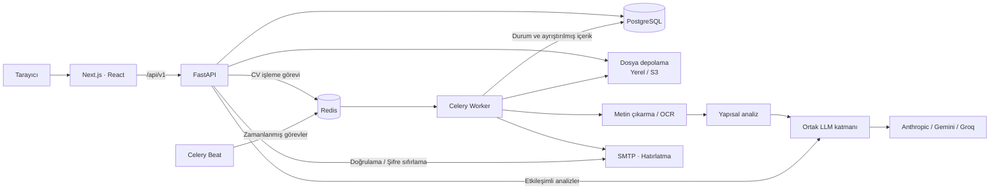
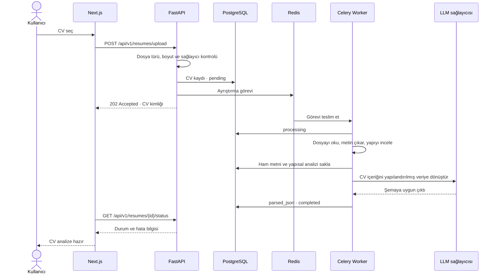
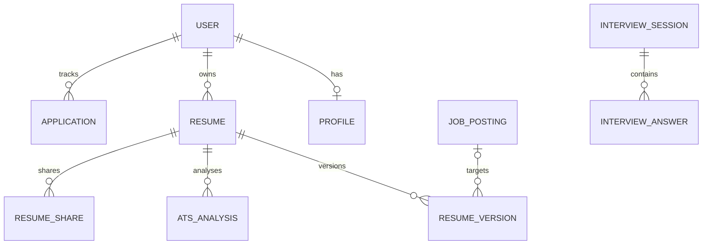

<div align="center">


# Veyra · CV Agent

**CV’den mülakata, başvuru sürecinin tamamı tek çalışma alanında.**

CV analizi · İş eşleştirme · Mülakat hazırlığı · Kariyer planlama

[](https://github.com/ilknurkucukberber/CV-agent-Veyra/actions/workflows/ci.yml)


[Kurulum](#kurulum) · [Test hesabı](#yerel-test-hesabı) · [Mimari](#mimari) · [Testler](#testler)

</div>

---

Veyra, iş ararken farklı araçlara dağılan işleri bir araya getirir. CV’yi yükleyip içeriğini düzenleyebilir, bir iş ilanıyla karşılaştırabilir, o pozisyon için mülakat çalışabilir ve başvuruların hangi aşamada olduğunu takip edebilirsiniz.

Arayüz gece mavisi ve lavanta tonları üzerine kurulu. Next.js ön yüzü, FastAPI servisiyle aynı adres üzerinden konuşur; dosya ayrıştırma işleri Celery worker’da yürür. Anthropic, Gemini ve Groq bağlantıları ortak bir yapılandırılmış çıktı katmanından geçer.

## Neler var?

| Alan | İşlev |
| --- | --- |
| **CV çalışma alanı** | PDF, DOCX, JPG ve PNG yükleme; metin çıkarma, görseller için OCR ve bölüm analizi |
| **ATS analizi** | CV’nin yapısını ve içeriğini değerlendirerek puan ve iyileştirme önerileri üretme |
| **CV editörü** | Farklı düzenleme seviyeleriyle yeniden yazım, sürüm geçmişi ve değişiklik karşılaştırması |
| **İş eşleştirme** | İlan metni veya URL üzerinden gereksinimleri çıkarma ve CV ile karşılaştırma |
| **Mülakat hazırlığı** | CV ve ilana göre soru üretme, cevapları değerlendirme ve görüşme notlarını saklama |
| **Kariyer yol haritası** | Hedef pozisyona yönelik adımlar oluşturma ve ilerlemeyi işaretleme |
| **LinkedIn** | Profil bölümleri için düzenleme önerileri |
| **Maaş tahmini** | Pozisyon, şehir ve deneyim seviyesine göre tahmini aralık; sonuçlar canlı piyasa verisi değildir |
| **Başvuru takibi** | Sürükle bırak Kanban panosu, görüşme tarihleri ve e-posta hatırlatmaları |
| **Paylaşım** | CV için iptal edilebilir bağlantı oluşturma |
| **Hesap yönetimi** | JWT ile oturum, e-posta doğrulama ve şifre sıfırlama |

## Kurulum

Docker Engine/Desktop, Compose v2 ve en az bir sağlayıcının API anahtarı gerekir. Docker kullanırken bilgisayarda ayrıca Python, Node.js veya PostgreSQL kurulması gerekmez.

```bash
git clone https://github.com/ilknurkucukberber/CV-agent-Veyra.git
cd CV-agent-Veyra
cp .env.example .env
```

`.env` dosyasında kullanılacak sağlayıcıyı ve anahtarını belirtin. Örneğin:

```dotenv
LLM_PROVIDER=gemini
GEMINI_API_KEY=YOUR_GEMINI_API_KEY
GEMINI_MODEL=gemini-3.8-flash
FRONTEND_ORIGIN=http://localhost:3006
```

Ardından servisleri başlatın:

```bash
docker compose up -d --build --wait
docker compose ps
```

| Servis | Yerel adres |
| --- | --- |
| Uygulama | [localhost:3006](http://localhost:3006) |
| API dokümantasyonu | [localhost:8000/api/v1/docs](http://localhost:8000/api/v1/docs) |
| API sağlık kontrolü | [localhost:8000/api/v1/health](http://localhost:8000/api/v1/health) |
| Veritabanı sağlık kontrolü | [localhost:8000/api/v1/health/db](http://localhost:8000/api/v1/health/db) |
| PostgreSQL | `localhost:5432` · veritabanı/kullanıcı/parola: `cvagent` |
| Redis | `localhost:6380` |

Backend açılışta Alembic migration’larını uygular. PostgreSQL ve Redis hazır olduktan sonra API, worker ve beat başlar; ön yüz API sağlık kontrolünü bekler.

### Yerel test hesabı

SMTP ayarlamadan uygulamayı denemek için doğrulanmış bir geliştirme hesabı oluşturabilirsiniz:

```bash
printf '%s\n' 'VeyraDemo2026!' | docker compose exec -T backend python -m app.create_test_user --password-stdin
```

| | Giriş bilgisi |
| --- | --- |
| Adres | [localhost:3006/login](http://localhost:3006/login) |
| E-posta | `demo@example.com` |
| Şifre | `VeyraDemo2026!` |

Bu bilgiler yalnızca yerel deneme hesabı içindir. Hesap oluşturma komutu `development` ortamı ve localhost adresiyle sınırlandırılmıştır; hesap her kurulumda bu komutla oluşturulur. CV analizi için ayrıca geçerli bir sağlayıcı anahtarı gerekir. Üretimde kişisel hesap ve farklı parola kullanın.

İlk deneme için oturum açın, metni seçilebilen bir PDF yükleyin ve ayrıştırma tamamlandığında ATS analizi veya iş eşleştirme ekranına geçin.

## Mimari



**Ön yüz:** Next.js App Router, React, TypeScript ve Tailwind CSS. Tarayıcı `/api/v1` adresine istek yapar; Next.js isteği Docker ağı içindeki `backend:8000` adresine iletir.

**API:** FastAPI router’ları kimlik doğrulama ve kullanıcıya ait kayıtlara erişimi yönetir. Pydantic modelleri istekleri ve yanıtları doğrular. SQLAlchemy veri erişimini, Alembic şema değişikliklerini yürütür.

**Arka plan işleri:** Celery worker CV ayrıştırır ve hatırlatma e-postalarını gönderir. Beat günlük hatırlatma görevini saat 08.00 UTC’de, Türkiye saatiyle 11.00’de kuyruğa ekler. Redis; uygulama bağlantısı, görev kuyruğu ve sonuç deposu için ayrı veritabanı indeksleri kullanır.

**Model bağlantısı:** Agent modülleri `parse_structured()` üzerinden çalışır. Sağlayıcı seçimi, çıktı doğrulama ve hata yönetimi ortak katmandadır. Geçici hatalar yeniden denenir; anahtar veya model ayarı hataları kullanıcıya açıklayıcı mesajla döner.

### CV yükleme akışı



Durum sırası `pending → processing → completed` şeklindedir. İşlem başarısız olursa durum `failed` olur; çıkarılan metin saklanır. **Yeniden işle** işlemi aynı CV kaydını kuyruğa alır, yeniden dosya yüklemeyi gerektirmez.

### Veri modeli



Şema, ana ilişkilerin sadeleştirilmiş görünümüdür. Ayrıntılı modeller `backend/app/models`, migration geçmişi `backend/alembic/versions` altında bulunur.

## Proje yapısı

```text
CV-agent-Veyra/
├── backend/
│   ├── app/
│   │   ├── agents/          # CV, ATS, ilan, mülakat ve kariyer işlemleri
│   │   ├── api/routes/      # HTTP endpoint’leri
│   │   ├── core/            # Ayarlar, güvenlik, LLM ve rate limit
│   │   ├── db/              # Veritabanı bağlantısı ve oturumlar
│   │   ├── models/          # SQLAlchemy modelleri
│   │   ├── schemas/         # Pydantic istek/yanıt modelleri
│   │   ├── services/        # Dosya, OCR, e-posta ve URL işleme
│   │   └── workers/         # Celery görevleri ve zamanlama
│   ├── alembic/versions/    # Şema migration’ları
│   ├── tests/               # API ve işlem akışı testleri
│   └── unit_tests/          # Sağlayıcı ve e-posta birim testleri
├── frontend/
│   ├── src/app/             # Sayfalar ve uygulama düzeni
│   ├── src/components/      # Editör, mülakat, dashboard ve Kanban
│   ├── src/lib/             # API istemcisi ve oturum yardımcıları
│   ├── src/types/           # TypeScript veri tipleri
│   └── public/              # Marka ve görsel dosyaları
├── nginx/                  # Ters proxy yapılandırması
├── .github/workflows/      # GitHub Actions
├── .env.example            # Ortam değişkenleri şablonu
├── docker-compose.yml      # Yerel geliştirme
└── docker-compose.prod.yml # Dağıtım yapılandırmasının temeli
```

## Yapılandırma

### Model sağlayıcısı

| `LLM_PROVIDER` | Anahtar | Model ayarı |
| --- | --- | --- |
| `gemini` | `GEMINI_API_KEY` | `GEMINI_MODEL` |
| `groq` | `GROQ_API_KEY` | `GROQ_MODEL` |
| `anthropic` | `ANTHROPIC_API_KEY` | `ANTHROPIC_MODEL` · backend ayarı |
| `auto` | Tanımlı anahtarlardan seçer | Öncelik: Anthropic → Gemini → Groq |

Bağlantıyı kontrol etmek için:

```bash
docker compose exec backend python -m app.check_ai
# Kurgusal CV ile gerçek sağlayıcı isteği yapar:
docker compose exec backend python -m app.check_ai --test
```

Model erişimi hesaba göre değişebilir. `404` hatasında `GEMINI_MODEL` veya seçilen sağlayıcının model ayarını kontrol edin. `.env` değişikliği çalışan konteynere kendiliğinden geçmez:

```bash
docker compose up -d --force-recreate --wait backend worker beat
```

### E-posta

Yeni hesap doğrulama, şifre sıfırlama ve başvuru hatırlatmaları gerçek SMTP üzerinden gönderilir. `.env` içinde şu alanları doldurun:

```dotenv
SMTP_HOST=YOUR_SMTP_HOST
SMTP_PORT=587
SMTP_USER=YOUR_SMTP_USERNAME
SMTP_PASSWORD=YOUR_SMTP_PASSWORD
SMTP_FROM_EMAIL=YOUR_VERIFIED_SENDER_EMAIL
SMTP_FROM_NAME=Veyra
SMTP_USE_SSL=false
SMTP_USE_TLS=true
SMTP_TIMEOUT_SECONDS=15
```

Gönderen adresi sağlayıcıda doğrulanmış olmalıdır. Port 587 için STARTTLS varsayılanını koruyun; port 465 kullanıyorsanız `SMTP_USE_SSL=true` ve `SMTP_USE_TLS=false` ayarlayın.

```bash
docker compose up -d --force-recreate --wait backend worker beat
# E-posta göndermeden bağlantı ve kimlik doğrulama kontrolü:
docker compose exec backend python -m app.email_check
# Belirttiğiniz adrese gerçek test e-postası gönderir:
docker compose exec backend python -m app.email_check --to your-test-address@example.com
```

SMTP kurulmadan normal kayıt akışı tamamlanamaz. Yerel test hesabı bu kurulumdan bağımsızdır.

### Dosya depolama ve dağıtım

Yerel Compose kurulumu dosyaları `backend/uploads/` altında tutar. PostgreSQL ve Redis verileri Docker volume’larında saklanır. S3 uyumlu depolama için `STORAGE_BACKEND=s3`, bucket, bölge ve erişim bilgileri kullanılır; isteğe bağlı `AWS_ENDPOINT_URL` farklı sağlayıcılara bağlanmayı sağlar.

`docker-compose.prod.yml`, Nginx ve S3 yapılandırması içerir. Dağıtımdan önce `JWT_SECRET`, veritabanı parolası, alan adı, SMTP ve depolama ayarlarını hazırlayın. HTTPS sonlandırması ayrıca kurulmalıdır; mevcut Nginx dosyası HTTP dinler. Üretimde `ENVIRONMENT=production` ve `DEBUG=false` değerlerini servis ortamına açıkça geçirin. Bu dosya doğrudan internete açılmaya hazır bir dağıtım reçetesi değildir.

`.env`, yüklenen CV’ler, yerel çıktı dosyaları, bağımlılıklar ve çalışma zamanı verileri Git’e dahil edilmez. API anahtarları `.env.example` içine yazılmaz.

## Geliştirme

Docker dışında geliştirme için Python 3.12 ve Node.js 24 kullanılabilir. PostgreSQL ve Redis’i Docker ile başlatın:

```bash
docker compose up -d postgres redis
```

**Backend**

```bash
cd backend
python3 -m venv .venv
source .venv/bin/activate
pip install -r requirements.txt
cp .env.example .env
# backend/.env içindeki bağlantı ve sağlayıcı ayarlarını düzenleyin.
# Yerel Compose Redis portu 6380’dir; REDIS_URL ve CELERY_* URL’lerinde kullanın.
alembic upgrade head
uvicorn app.main:app --reload
```

Worker ve beat’i ayrı terminallerde, aynı sanal ortam ve ayarlarla çalıştırın:

```bash
celery -A app.workers.celery_app:celery_app worker --loglevel=info
celery -A app.workers.celery_app:celery_app beat --loglevel=info
```

**Frontend**

```bash
cd frontend
npm ci
cp .env.example .env.local
npm run dev -- --port 3006
```

Ön yüzün yerel backend adresi `API_INTERNAL_URL=http://127.0.0.1:8000` olmalıdır. Backend için `FRONTEND_ORIGIN=http://localhost:3006` kullanın.

Migration oluşturma:

```bash
cd backend
alembic revision --autogenerate -m "describe schema change"
alembic upgrade head
```

Yeni model eklerken Alembic’in görebilmesi için `backend/app/db/base.py` içindeki model import’larını da güncelleyin.

## Testler

Backend testleri geliştirme veritabanından ayrı `cvagent_test` veritabanında çalışır. Testler bu veritabanının şemasını sıfırlar; aşağıdaki komutu ilk çalıştırmada kullanın:

```bash
docker compose exec postgres createdb -U cvagent cvagent_test
docker compose exec backend pytest -q
```

Gerçek sağlayıcı çağrıları API testlerinde sabit verilerle değiştirilir. SMTP gönderimi de izole edilir. Dosya yükleme, yetkilendirme, CV ayrıştırma, yeniden işleme, paylaşım, analiz, mülakat ve başvuru akışları test edilir.

```bash
# Yalnızca CV akışı
docker compose exec backend pytest -q tests/test_resumes.py
# Sağlayıcı hata yönetimi
docker compose exec backend python -m unittest discover -s unit_tests -p test_llm_errors.py
# Frontend
cd frontend
npm test
npx tsc --noEmit
npm run build
```

GitHub Actions; backend testlerini PostgreSQL ve Redis ile, ön yüz testlerini ise TypeScript kontrolü ve üretim derlemesiyle birlikte çalıştırır.

## Sık kullanılan komutlar

```bash
# Durum ve loglar
docker compose ps
docker compose logs --tail=100 backend worker frontend

# Arayüz değişikliğinden sonra yeniden derleme
docker compose up -d --build --wait frontend

# Servisleri durdurma; veritabanı volume’ları korunur
docker compose down
```

| Belirti | Kontrol |
| --- | --- |
| CV yükleniyor, analiz başarısız | Worker logları, sağlayıcı anahtarı, model erişimi ve kota |
| CV yeniden yüklenmeden tekrar denenecek | CV ekranında **Yeniden işle** |
| Tarayıcı API’ye ulaşamıyor | Frontend ve backend sağlık kontrolleri, proxy adresi |
| Yeni kod arayüzde görünmüyor | Frontend imajını yeniden derleyin |
| Worker eski ayarlarla çalışıyor | İlgili servisleri `--force-recreate` ile başlatın |
| Görselden metin çıkmıyor | Görsel okunaklılığı, Tesseract ve Türkçe/İngilizce dil paketleri |
| Taranmış PDF boş okunuyor | Metni seçilebilen PDF/DOCX veya OCR için JPG/PNG kullanın |
| Doğrulama e-postası gelmiyor | SMTP bağlantısı, doğrulanmış gönderen ve sağlayıcının teslim kayıtları |

---

Geliştiren: [İlknur Küçükberber](https://github.com/ilknurkucukberber)
